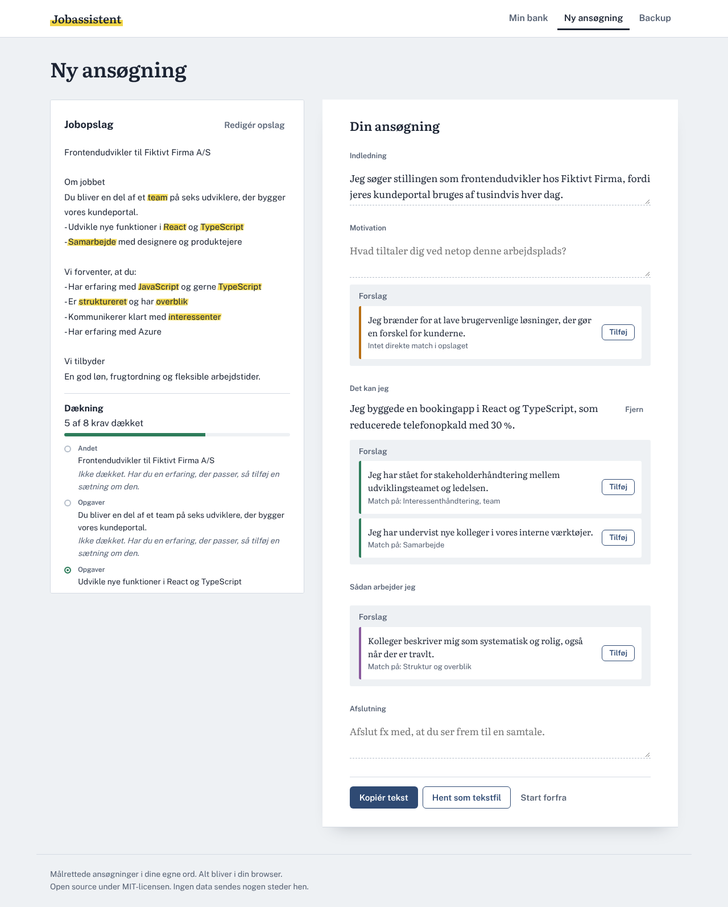

# Jobassistent

Write targeted job applications from your own sentences, without AI costs. Everything stays in your browser.

*Skriv målrettede ansøgninger ud fra dine egne sætninger. Alt bliver i din browser.*



## How it works

1. **Build your statement bank.** Write short sentences about what you have done and can do: results, skills, how you work and what motivates you.
2. **Paste a job posting.** The app splits it into requirements, finds the competences it asks for and highlights the words that match your bank.
3. **Compose the application.** For each part of the letter you get ranked suggestions from your bank and an explanation of why they match. You write the opening and motivation yourself.
4. **See your coverage.** The app shows which requirements your bank covers and which ones are missing.
5. **Save and export.** Save applications to reopen them later, and download them as a Word file, print or save as PDF, or copy the text into a job portal.

## Why no AI?

- **Cost:** the app can serve any number of users for free, because all logic runs in the browser.
- **Authenticity:** every sentence in the application is written by you.
- **Privacy:** nothing is sent anywhere. There is no server.

Matching uses classic, explainable techniques: Danish stemming, a synonym dictionary of competences, compound word splitting and BM25 ranking.

## Development

Requires Node.js 20 or later.

```bash
npm install
npm run dev        # web app at http://localhost:5173
npm test           # core tests
npm run build      # production build in apps/web/dist
```

See [CONTRIBUTING.md](CONTRIBUTING.md) for project structure and code conventions.

## Roadmap

- [x] Statement bank with local storage, export and import
- [x] Posting analysis with synonym matching, highlights and coverage
- [x] Export as Word (DOCX), print/PDF and plain text, with your contact details
- [x] Save and reopen applications
- [ ] Learn from your edits
- [ ] Import an existing CV
- [ ] Optional semantic matching with a small embedding model running in the browser

## License

[MIT](LICENSE)
